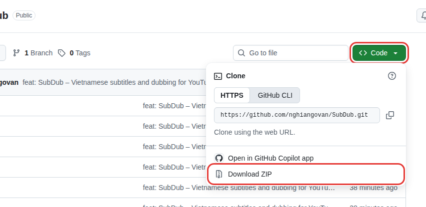
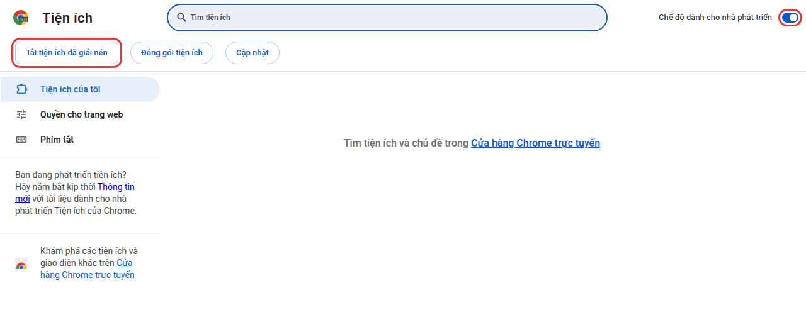
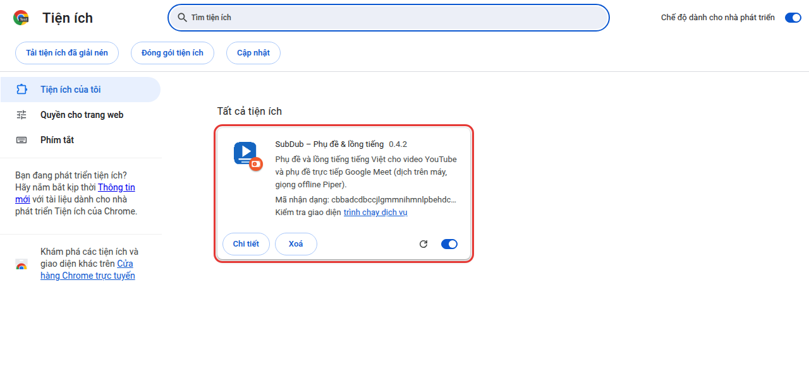
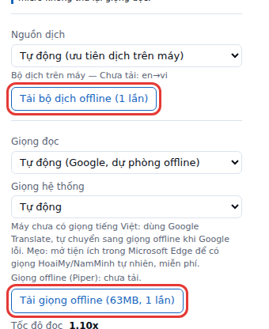
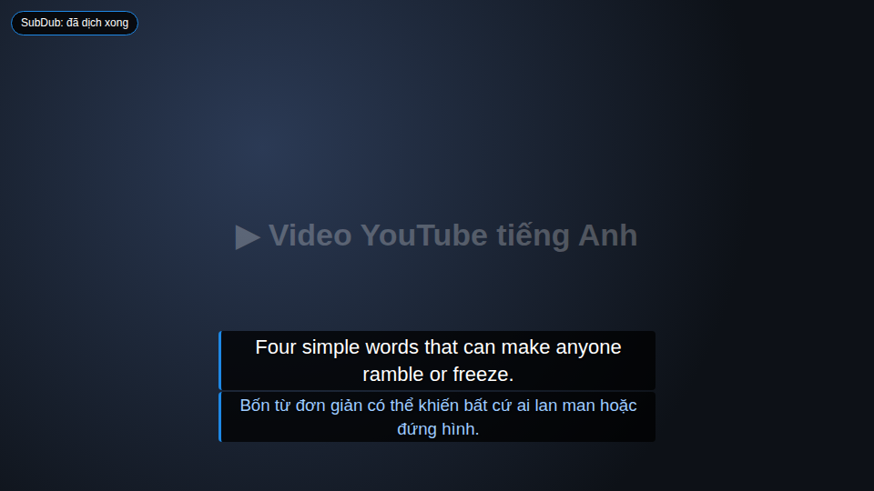

# SubDub – Phụ đề & lồng tiếng

Tiện ích Chrome (Manifest V3) hiển thị **phụ đề tiếng Việt** ngay trên trình phát YouTube và **lồng tiếng Việt**, đồng bộ theo thời gian video. **Miễn phí, không giới hạn, không cần tài khoản hay khoá API**: dịch và đọc đều có phương án chạy hoàn toàn trên máy. Ngoài YouTube, tiện ích còn dịch **phụ đề trực tiếp của Google Meet** sang tiếng Việt (xem mục *Google Meet*). Không cần build, không cần npm.

## Hướng dẫn cài đặt cho người mới (khoảng 5 phút)

Không cần biết lập trình, chỉ cần máy tính có **Google Chrome**. Làm lần lượt từng bước dưới đây.

### Bước 1: Tải tiện ích về máy

Vào trang **https://github.com/nghiangovan/SubDub**, bấm nút xanh **Code**, rồi chọn **Download ZIP**. Máy sẽ tải về file `SubDub-main.zip`.



### Bước 2: Giải nén

1. Mở thư mục **Downloads (Tải xuống)**, bấm **chuột phải** vào file `SubDub-main.zip` và chọn **Giải nén tất cả… (Extract All…)**, rồi bấm **Giải nén (Extract)**.
2. Chuyển thư mục vừa giải nén ra một chỗ cố định, ví dụ **Documents (Tài liệu)**.

> ⚠️ **Đừng xoá hay di chuyển thư mục này sau khi cài.** Chrome chạy tiện ích trực tiếp từ thư mục đó. Nếu thư mục mất, tiện ích cũng mất.

### Bước 3: Mở trang Tiện ích của Chrome

Gõ `chrome://extensions` vào thanh địa chỉ của Chrome rồi bấm **Enter**.

### Bước 4: Bật chế độ nhà phát triển và nạp tiện ích

1. Bật công tắc **Chế độ dành cho nhà phát triển** ở **góc trên bên phải**.
2. Bấm nút **Tải tiện ích đã giải nén** ở góc trên bên trái.



3. Một cửa sổ chọn thư mục hiện ra. Mở thư mục `SubDub-main` đã giải nén ở bước 2 rồi bấm **Chọn thư mục (Select Folder)**.

> 💡 Windows thường tạo **hai thư mục lồng nhau**: `SubDub-main` → `SubDub-main`. Hãy chọn **thư mục bên trong**, tức thư mục có các file `manifest.json`, `background.js` cùng các thư mục `content`, `popup`… Nếu Chrome báo **"Không có tệp kê khai"** (*Manifest file is missing*), nghĩa là bạn đã chọn thư mục ngoài. Bấm lại nút ở bước 4.2 và chọn thư mục bên trong.

### Bước 5: Kiểm tra và ghim tiện ích

Nếu thấy thẻ **SubDub – Phụ đề & lồng tiếng** như hình dưới là đã cài xong.



Để tiện mở cài đặt sau này, hãy ghim tiện ích lên thanh công cụ: bấm biểu tượng **mảnh ghép 🧩** ở góc trên bên phải Chrome, rồi bấm **cái ghim 📌** cạnh chữ **SubDub**.

### Bước 6: Tải bản offline (chỉ 1 lần, nên làm)

Bấm biểu tượng **SubDub** trên thanh công cụ để mở bảng cài đặt, rồi bấm hai nút trong khung đỏ:

- **Tải bộ dịch offline (1 lần)**: dịch ngay trên máy, không giới hạn.
- **Tải giọng offline (63MB, 1 lần)**: giọng đọc dự phòng, dùng khi Google tạm chặn giọng đọc.



### Bước 7: Dùng thử

- **YouTube:** mở một video **tiếng Anh có phụ đề** (kể cả phụ đề tự động). Phụ đề tiếng Việt hiện ngay trên video và giọng Việt bắt đầu đọc. Có thể **kéo phụ đề** sang chỗ khác. **Nhấp đúp** vào phụ đề để đưa nó về chỗ cũ.
- **Google Meet:** vào cuộc họp, tiện ích tự bật phụ đề CC của Meet và hiện bảng dịch. Nhớ **đeo tai nghe**, để micro không thu lại giọng đọc.



### Cập nhật lên bản mới

1. Làm lại **bước 1 và 2** để tải và giải nén bản mới, rồi **chép đè** vào đúng thư mục cũ.
2. Vào `chrome://extensions`, bấm nút **tải lại ⟳** trên thẻ SubDub.
3. Tải lại (F5) các tab YouTube hoặc Meet đang mở.

Cài đặt của bạn được giữ nguyên.

### Gặp trục trặc?

- **Chrome hiện thông báo "Tắt các tiện ích ở chế độ nhà phát triển"**: bấm **X** để đóng, đừng bấm *Tắt*. Đây là cảnh báo bình thường với tiện ích không cài từ Cửa hàng Chrome.
- **Không thấy phụ đề:** video phải có phụ đề tiếng Anh (nút **CC** trên YouTube). Thử tải lại trang (F5).
- **Không nghe thấy giọng đọc:** trong bảng cài đặt, chọn *Chế độ* = **Cả hai**, và kiểm tra thanh **Âm lượng giọng lồng tiếng**.
- **Giọng đọc đổi sang giọng khác, nghe "máy" hơn:** Google đang tạm chặn giọng đọc. Tiện ích tự chuyển sang giọng offline rồi quay lại giọng Google sau ít phút.

## Tính năng

- Bắt phụ đề của video (hook `/api/timedtext` + danh sách `captionTracks`, có phương án dự phòng).
- Gộp các mảnh phụ đề thành câu, dịch sang tiếng Việt, lưu cache (tối đa 50 video).
- Lớp phụ đề tuỳ chỉnh trên trình phát (tuỳ chọn hiện dòng gốc bên dưới), hoạt động ở chế độ toàn màn hình.
- **Dịch trên máy** bằng Translator API có sẵn của Chrome (Chrome 138+ trên máy tính): offline, không giới hạn. Mặc định là *Tự động*: dùng dịch trên máy nếu đã cài, nếu không dùng Google Dịch; nếu một nguồn bị chặn/lỗi giữa chừng thì phần còn lại tự chuyển sang nguồn kia.
- Các nguồn dịch khác: Google Dịch (miễn phí, không chính thức), YouTube (`tlang=vi`), Claude API (tuỳ chọn, cần khoá).
- Lồng tiếng: giọng hệ thống `speechSynthesis` (`vi-*`) nếu có, **Google Translate TTS** (mặc định khi máy không có giọng Việt) và **giọng offline Piper** (`vi_VN-vais1000-medium`) làm dự phòng tự động; tự giảm âm lượng video gốc khi đọc.
- Hỗ trợ điều hướng SPA, tua video, tạm dừng, đổi tốc độ phát, quảng cáo.
- **Google Meet**: đọc phụ đề CC tiếng Anh của cuộc họp, dịch từng câu hoàn chỉnh sang tiếng Việt, hiện trong bảng nổi và (tuỳ chọn) lồng tiếng cho riêng bạn.

## Thiết kế miễn phí và không giới hạn

Nguyên tắc: không tài khoản, không khoá API, và việc nghe **không bao giờ dừng giữa chừng** chỉ vì một dịch vụ giới hạn tần suất.

| Việc | Chạy trên máy (offline, không giới hạn) | Chạy online (miễn phí, không chính thức, có thể bị giới hạn) |
| --- | --- | --- |
| Dịch phụ đề | Translator API của Chrome (mô hình do Chrome quản lý) | Google Dịch (`translate.googleapis.com`, endpoint gtx), YouTube `tlang`, Claude (tuỳ chọn) |
| Giọng đọc | Piper `vi_VN-vais1000-medium` (ONNX + WASM trong tài liệu offscreen); giọng hệ thống `vi-*` | Google Translate TTS (`translate.google.com/translate_tts`) |

**Hai thao tác tải một lần** (nằm trong popup, sau đó dùng không cần mạng):

1. **"Tải bộ dịch offline (1 lần)"**: Chrome tải mô hình dịch (ví dụ en→vi). Cần bấm tay vì Chrome yêu cầu thao tác của người dùng (user gesture) để tạo bộ dịch khi mô hình chưa có. Nút hiện trạng thái hiện tại (đã sẵn sàng / chưa tải / đang tải / không hỗ trợ). Nếu video đang mở có ngôn ngữ khác tiếng Anh, popup cũng tải gói của ngôn ngữ đó.
2. **"Tải giọng offline (63MB, 1 lần)"**: tải `vi_VN-vais1000-medium.onnx` (+ `.json`) từ `huggingface.co/rhasspy/piper-voices`, kiểm tra kích thước và SHA-256, lưu vào Cache Storage của tiện ích. Việc tải chạy trong tài liệu offscreen nên có thể đóng popup. Nếu chọn "Offline (Piper)" mà chưa tải, tiện ích tự tải một lần (Google đọc tạm trong lúc đó).

**Hành vi dự phòng**

- *Dịch*: `Tự động` = dịch trên máy nếu mô hình đã cài và cặp ngôn ngữ được hỗ trợ (ngôn ngữ gốc lấy từ `languageCode` của track phụ đề, ví dụ `en-US` → `en`), ngược lại Google. Khi nguồn đang dùng lỗi 2 lần liên tiếp (429, mạng...) nó bị "tạm nghỉ" 60 giây và các đoạn chưa dịch chuyển sang nguồn còn lại (Google ⇄ dịch trên máy). Mọi lựa chọn (Google, Claude, YouTube) đều có dịch trên máy làm dự phòng nếu mô hình đã cài. Nếu mọi nguồn đều lỗi thì hiện thông báo và tự thử lại sau thời gian nghỉ.
- *Giọng đọc*: `Tự động` = giọng hệ thống (nếu có) → Google Translate; **khi Google lỗi bất kỳ (429/mạng/quá thời gian) dòng đang đọc được chuyển ngay sang Piper** (không có khoảng lặng, không trả lại âm lượng gốc) và giữ Piper trong 60 giây trước khi thử lại Google. Thông báo: "SubDub: Google tạm chặn, đang dùng giọng offline". Nếu chưa tải Piper: như trước đây (trả lại âm lượng gốc, `chrome.tts`), kèm thông báo gợi ý bấm "Tải giọng offline".
- *Giảm bị Google chặn*: âm thanh Google đã đọc được **lưu lại trên máy** (Cache Storage, tối đa ~2000 câu), nên xem lại video hay gặp câu lặp lại thì không gửi yêu cầu mới. Mỗi lúc chỉ gửi tối đa 2 yêu cầu, và câu đang đọc được ưu tiên hơn câu tải trước. Khi Google chặn (HTTP 429 hoặc chuyển sang trang `/sorry`), tiện ích ngừng gọi Google lần lượt **1 phút, 5 phút, rồi 15 phút** và dùng giọng offline trong lúc chờ. Chỉ cần một lần đọc thành công là thời gian chờ quay về 1 phút.

**Translator API chạy ở đâu?** Khi bắt đầu dịch, content script thăm dò theo thứ tự: (1) tài liệu **offscreen** của tiện ích (origin của tiện ích, dùng chung cho mọi tab, không bị YouTube hay việc làm chậm tab ảnh hưởng); (2) nếu offscreen không có `Translator` thì chạy ngay trong **content script** của tab YouTube; (3) nếu cả hai không có thì dùng Google. Luồng thông điệp: content → `background.js` (`localTr`) → offscreen (`trProbe`/`trTranslate`). Mỗi đoạn là một chuỗi riêng (API nhận từng chuỗi), song song 3 đoạn, bắt đầu từ vị trí đang phát. Cache dùng khoá nhà cung cấp `local` (cùng bộ nhớ đệm từng video).

## Google Meet

Tiện ích đọc **phụ đề trực tiếp (CC) của chính Meet**, dịch từng câu tiếng Anh đã hoàn chỉnh sang tiếng Việt và hiện trong một bảng nổi trên cuộc họp. Hoàn toàn miễn phí, không giới hạn, không tài khoản hay khoá API: dịch bằng Translator API của Chrome (trên máy) trước, Google Dịch làm dự phòng và tự chuyển qua lại; giọng đọc dùng cùng các giọng như YouTube (Google Translate TTS mặc định, Piper offline dự phòng, có chỉnh âm lượng).

**Cách dùng**

1. Vào cuộc họp trên `meet.google.com`.
2. **Bật phụ đề CC** (nút *Turn on captions* hoặc nhấn phím `c`).
3. Trong cài đặt phụ đề của Meet, chọn **Meeting language = English**.
4. Bảng "SubDub · Phụ đề Meet" tự xuất hiện ở giữa phía dưới. Nếu CC chưa bật, bảng hiện nhắc: "Bật CC (phím c) và chọn Meeting language = English". Mặc định tiện ích **tự bật CC một lần** khi bạn vào cuộc họp (tắt được trong popup: "Tự bật phụ đề (CC) của Meet khi vào cuộc họp"). Đó là nút duy nhất của Meet mà tiện ích bấm; nếu bạn tự tắt CC thì tiện ích để yên cho tới cuộc họp sau.

**Bảng phụ đề**

- Mỗi câu gồm tên người nói (xanh dương), **câu gốc tiếng Anh ở trên (cỡ đầy đủ)** và **bản dịch tiếng Việt ở dưới (nhỏ hơn một chút, 0,85em, xanh nhạt `#9ecbff`)**, giống lớp phụ đề trên YouTube. Bảng giữ toàn bộ các câu: cuộn lên để đọc lại câu cũ (đang cuộn thì câu mới không kéo bạn xuống; bấm **↓ Mới nhất** để về cuối). Bấm vào một câu tiếng Anh hoặc tiếng Việt để **sao chép riêng câu đó**. Kèm câu đang nói dở (chữ mờ; bản dịch nháp của câu dở chỉ có khi dùng dịch trên máy).
- Kéo thanh tiêu đề để di chuyển, kéo **bất kỳ cạnh hoặc góc nào** (trên, dưới, trái, phải) để đổi kích thước, nút `–`/`+` để thu gọn. Vị trí và kích thước được nhớ; popup có nút **Đặt lại vị trí bảng phụ đề**.
- Nút **Lịch sử** mở toàn bộ bản ghi cuộc họp (giờ, người nói, EN, VI) với **Sao chép** và **Tải .txt** (tạo file ngay trong trang, không gửi đi đâu).
- Cỡ chữ dùng chung thanh "Cỡ chữ phụ đề" với YouTube; chế độ (*Chỉ phụ đề / Chỉ lồng tiếng / Cả hai*) cũng là cài đặt chung, mặc định **Cả hai**. Ở chế độ *Chỉ lồng tiếng* bảng được ẩn.

**Cách xử lý câu**

Meet gửi chữ từng từ một, hay **viết lại** vài từ cuối (ví dụ "... problem. We." thành "... problem. Can we schedule ...?") và đẩy chữ cũ ra khỏi phía trước. `lib/sentences.js` (hàm thuần, có kiểm thử với dữ liệu thật trong `tests/fixtures/meet-captions.json`) chỉ coi một câu là **chính thức** khi nó kết thúc bằng `. ? !` và đã có chữ nối tiếp phía sau (hoặc người nói ngừng 1,5 giây). Câu quá ngắn (dưới 2 từ, như "We.") được gộp vào câu kế. Mỗi câu chính thức được dịch **đúng một lần**; câu đã dịch không bị dịch lại khi chữ trượt khỏi phía trước.

**Lồng tiếng trong Meet**

- Giống YouTube nhưng không có video: các câu được đọc lần lượt, **không hạ âm lượng của Meet**.
- Ưu tiên cái mới nhất: tối đa 2 câu chờ, câu cũ hơn bị bỏ (và câu chờ quá 15 giây bị bỏ); khi có câu chờ, tốc độ đọc tăng dần (tối đa theo "Tốc độ đọc tối đa").
- Mặc định **không đọc lời của chính bạn** ("You"/"Bạn"); tắt trong popup nếu muốn.
- **Hãy đeo tai nghe** để micro không thu lại giọng đọc (popup có nhắc).

**Hạn chế**

- Chất lượng bị giới hạn bởi **nhận dạng giọng nói của Meet**: giọng nặng (ví dụ Ấn Độ nặng, Ả Rập) có thể bị nhận sai một phần hoặc mất chữ. Vì vậy bảng luôn hiện kèm câu gốc để bạn tự đánh giá.
- Chỉ đọc phụ đề tiếng Anh (Meeting language phải là English). Chỉ hoạt động khi CC đang bật trong tab đó.
- Nhận diện vùng phụ đề dựa trên giao diện hiện tại của Meet (`role="region"` có nhãn "Captions" hoặc bản địa hoá, kèm phương án dự phòng); nếu Google đổi giao diện, bảng có thể không bắt được chữ.
- Nhiều tab cùng lồng tiếng sẽ dùng chung một bộ phát (như YouTube).

**Quyền riêng tư**

- Khi dùng **dịch trên máy** (Translator API của Chrome), nội dung phụ đề **không rời khỏi máy**.
- Khi phải dùng **Google Dịch dự phòng** (chưa tải mô hình, hoặc dịch trên máy lỗi), **văn bản phụ đề (từng câu) được gửi tới Google** (`translate.googleapis.com`); giọng Google Translate TTS cũng gửi câu tiếng Việt tới `translate.google.com`. Muốn tránh hoàn toàn, chọn nguồn dịch "Dịch trên máy" và giọng "Offline (Piper)" sau khi đã tải hai gói trong popup.
- Bản ghi cuộc họp chỉ nằm trong bộ nhớ của tab và mất khi tải lại trang; tiện ích không lưu nó vào đâu cả (chỉ vị trí/kích thước bảng được lưu).

## Cài đặt nhanh (cho người đã quen)

1. Mở `chrome://extensions`.
2. Bật **Developer mode** (Chế độ dành cho nhà phát triển).
3. Chọn **Load unpacked** và trỏ tới thư mục này (thư mục chứa `manifest.json`).
4. Mở một video YouTube có phụ đề, bấm biểu tượng tiện ích để chỉnh cài đặt và (một lần) bấm hai nút tải offline.

**Lưu ý:** trường `key` trong `manifest.json` giữ cố định ID của tiện ích (`cbbadcdbccjlgmmnihmnlpbehdcidoeh`), nên đổi tên hay chuyển thư mục cũng không mất cài đặt. Đừng xoá trường này.

Thư mục `vendor/` chứa mã chạy offline (onnxruntime-web, piper-phonemize/espeak-ng WASM) kèm giấy phép, xem `vendor/NOTICE.md`; dung lượng thư mục khoảng 32 MB, **không** chứa mô hình giọng (mô hình là dữ liệu, tải ở lần dùng đầu).

(Tạo lại biểu tượng nếu cần: `node scripts/gen-icons.js`. Chạy kiểm thử: `node tests/run.js`.)

## Cài đặt trong popup

Bật/tắt chung, **công tắc theo trang (YouTube / Google Meet)**, mục **Google Meet** (hiện câu gốc, không đọc lời của tôi, đặt lại vị trí bảng, nhắc đeo tai nghe), chế độ (chỉ phụ đề / chỉ lồng tiếng / cả hai), hiện dòng gốc (YouTube), nguồn dịch (Tự động / Dịch trên máy / Google / YouTube / Claude, + khoá API và mô hình Claude, tuỳ chọn "Dịch ngắn gọn"; trạng thái bộ dịch offline và nút "Tải bộ dịch offline (1 lần)"), **Giọng đọc** (Tự động (Google, dự phòng offline) / Google Translate / Offline (Piper) / Giọng hệ thống; trạng thái và nút "Tải giọng offline (63MB, 1 lần)") và giọng hệ thống, tốc độ đọc, tốc độ đọc tối đa, ngưỡng tốc độ video để tắt lồng tiếng, **âm lượng giọng lồng tiếng** (`dubVolume`, 0–100%, mặc định 100%), **âm lượng video gốc khi lồng tiếng** (`duckLevel`), cỡ chữ, **độ đậm nền phụ đề** (`subBgOpacity`, 0–100%, mặc định 75%), nút **Đặt lại vị trí phụ đề YouTube**, nút **Xoá cache**.

Trên YouTube có thể **kéo phụ đề** tới chỗ khác trong khung video. Vị trí được lưu theo tỉ lệ khung, nên vẫn giữ đúng khi vào toàn màn hình. **Nhấp đúp** vào phụ đề để đưa về chỗ cũ. Bấm vào phụ đề không làm dừng video. Khoá API Claude chỉ lưu trong `chrome.storage.local` và không bao giờ được ghi log.

## Âm lượng giọng lồng tiếng và phím tắt

- **Âm lượng giọng lồng tiếng** (`dubVolume`, 0–100%, bước 5%, mặc định 100%) chỉ ảnh hưởng tới giọng đọc, độc lập với **Âm lượng video gốc khi lồng tiếng** (`duckLevel`, mức video gốc bị hạ xuống khi đang đọc). Áp dụng cho mọi giọng: `speechSynthesis`, Google Translate TTS và `chrome.tts`.
- Kéo thanh trượt khi đang đọc bằng Google Translate TTS: âm lượng đổi ngay lập tức; với giọng hệ thống và `chrome.tts` thì áp dụng từ câu kế tiếp.
- **Phím tắt** trên trang YouTube (không hoạt động khi đang gõ trong ô nhập liệu): `Alt+Shift+↑` tăng, `Alt+Shift+↓` giảm âm lượng giọng lồng tiếng 10%. Giá trị được lưu vào `chrome.storage.sync` (thanh trượt trong popup tự đồng bộ) và hiện thông báo kiểu "SubDub: giọng lồng tiếng 70%".

## Lồng tiếng khi xem nhanh (1.5x, 1.75x, 2x)

- **Ngân sách thời gian:** thời gian thực có để đọc một câu = `(end - start) / playbackRate`. Tốc độ đọc cần thiết = thời gian đọc ước tính / thời gian có sẵn, không thấp hơn tốc độ đọc người dùng chọn và bị chặn bởi `ttsMaxRate` (mặc định 2.0).
- **Tự hiệu chỉnh:** đo thời gian thật của giọng đọc (từ `onstart`/`onend`), tính giây/ký tự bằng trung bình trượt (EMA), khởi tạo 0.065 s/ký tự ở tốc độ 1x, rồi dùng giá trị này thay cho hằng số cố định.
- **Khi quá tải** (cần tốc độ > tối đa): nếu câu kế tiếp bắt đầu trong vòng 0.3 giây thì chỉ gộp vào cùng một lượt đọc khi việc gộp làm giảm tốc độ cần thiết; nếu không thì đọc ở tốc độ tối đa. Không xếp hàng đợi: chỉ giữ tối đa một câu chờ (câu mới nhất); khi câu mới bắt đầu mà lượt đọc hiện tại trễ hơn 1.0 giây (thời gian thực) thì huỷ và nhảy sang câu hiện tại.
- **Claude + "Dịch ngắn gọn" (mặc định bật):** mỗi câu được gửi kèm giới hạn ký tự (ước tính cho tốc độ 1.5x) để Claude dịch gọn, văn nói tự nhiên.
- **Quá tốc độ cho phép:** khi tốc độ phát lớn hơn `dubMaxSpeed` (mặc định 2.0) lồng tiếng tạm tắt (chỉ còn phụ đề), âm lượng gốc được khôi phục và hiện thông báo "Lồng tiếng tạm tắt ở tốc độ > 2x". Sự kiện `ratechange` được xử lý ngay lập tức.

## Hạn chế

- Cần video có phụ đề (kể cả tự động tạo). Video không có phụ đề: chưa hỗ trợ nhận dạng giọng nói.
- Endpoint Google Dịch miễn phí không chính thức, có thể bị giới hạn tốc độ (đã có dự phòng dịch trên máy nếu mô hình đã cài).
- Translator API của Chrome chỉ có trên Chrome 138+ máy tính và tuỳ mô hình/cặp ngôn ngữ mà Chrome hỗ trợ; chất lượng dịch trên máy khác Google Dịch. Việc tạo bộ dịch lần đầu cần thao tác bấm nút trong popup.
- Piper chạy 1 luồng WASM nên có thể chậm hơn thời gian thực trên máy yếu khi xem nhanh; giọng nghe khác Google (giọng một người nói, chất lượng "medium").
- Mã vendor có espeak-ng (GPL-3.0); xem `vendor/NOTICE.md` nếu định phân phối lại.
- Chất lượng/độ có sẵn của giọng tiếng Việt tuỳ hệ điều hành; nếu không có sẽ dùng Google Translate (xem mục dưới), và `chrome.tts` chỉ là phương án cuối cùng.
- Cache của Claude tách riêng chế độ ngắn gọn và không ngắn gọn. Cache bản dịch dùng khoá `local`/`google`/`youtube`/`claude`; chế độ Tự động đọc cả `local` rồi `google`.
- Chỉ hỗ trợ `www.youtube.com/watch` (và Google Meet, xem mục riêng).

## Giọng đọc (TTS)

Cài đặt **Giọng đọc** (`ttsEngine`) có 4 lựa chọn:

- **Tự động (Google, dự phòng offline)** (mặc định): dùng giọng tiếng Việt của hệ thống nếu có; nếu không có thì dùng Google Translate; khi Google lỗi thì dùng Piper (nếu đã tải) trong 60 giây rồi thử lại Google. Thanh trạng thái hiện "SubDub: dùng giọng Google Translate (tiếng Việt)".
- **Google Translate**: luôn ưu tiên Google (vẫn chuyển sang Piper khi Google lỗi và Piper đã tải).
- **Offline (Piper)**: luôn dùng Piper, không cần mạng sau khi đã tải giọng (chưa tải thì tự tải một lần, Google đọc tạm).
- **Giọng hệ thống**: chỉ dùng `speechSynthesis` (chọn giọng ở ô bên dưới). Nếu máy không có giọng `vi-*` thì dùng Piper nếu đã tải, nếu không thì `chrome.tts` (có thể không phát ra tiếng).

Về giọng Google Translate:

- Miễn phí nhưng **không chính thức** (endpoint `translate.google.com/translate_tts` không có tài liệu hay cam kết), nên có thể bị giới hạn tần suất (HTTP 429), thay đổi hoặc ngừng hoạt động bất cứ lúc nào.
- Văn bản dài được cắt thành từng đoạn tối đa 200 ký tự (ưu tiên cắt ở dấu câu, dấu phẩy, rồi khoảng trắng) và phát lần lượt. Tiện ích tải trước âm thanh của 2 câu kế tiếp để giảm độ trễ khi xem 1.5x/1.75x.
- Âm thanh phát trong một tài liệu offscreen (`offscreen.html`) của tiện ích nên không bị chính sách CSP của YouTube chặn; tốc độ đọc dùng `playbackRate` (giữ nguyên cao độ) theo cùng cơ chế ngân sách thời gian ở trên. Hiệu chỉnh giây/ký tự được tách riêng cho từng loại giọng (`google`, `piper`, giọng hệ thống, `chrome.tts`).
- Nhiều tab cùng lồng tiếng một lúc sẽ dùng chung một bộ phát, nên chỉ nên lồng tiếng ở một tab tại một thời điểm.

Về giọng offline Piper:

- Mô hình `vi_VN-vais1000-medium` (giấy phép dữ liệu CC BY 4.0, bộ VAIS-1000) chạy bằng onnxruntime-web (WASM, 1 luồng) và phonemizer espeak-ng/piper-phonemize (WASM) trong một Web Worker do tài liệu offscreen tạo, nên không làm nghẽn việc nhận lệnh tạm dừng/huỷ. Mã chạy được đóng gói sẵn trong `vendor/` (MV3 không cho nạp mã từ xa); chỉ có **mô hình** được tải từ Hugging Face. Host cần quyền: `huggingface.co` và `*.hf.co` (CDN mà Hugging Face chuyển hướng tới, ví dụ `us.aws.cdn.hf.co`).
- Văn bản được chuẩn hoá nhẹ trước khi đọc (bỏ URL, `[Âm nhạc]`, ký hiệu nhạc, emoji; `50%` → "50 phần trăm", `$20` → "20 đô la", `1,000` → `1000`, `&` → "và"...), cắt thành khối ≤ 180 ký tự, tổng hợp ra WAV, cắt khoảng lặng đầu/cuối rồi phát bằng cùng bộ phát (`playbackRate`, `preservesPitch`, âm lượng, tạm dừng/tiếp tục/huỷ, tải trước 2 câu kế tiếp, cache LRU theo engine + giọng + văn bản).
- Tốc độ tổng hợp phụ thuộc CPU (1 luồng WASM): thường khoảng 0.25 giây tổng hợp cho mỗi giây âm thanh sau khi đã nạp mô hình (lần đầu nạp khoảng 2.5 giây). Khi lồng tiếng bắt đầu, nếu có thể dùng Piper tiện ích nạp mô hình sẵn để việc chuyển từ Google sang Piper gần như tức thì.

**Người dùng Windows** có thể cài gói giọng nói tiếng Việt để có giọng hệ thống (không cần mạng): *Settings → Time & language → Speech → Add voices* và chọn Tiếng Việt (Vietnamese), sau đó khởi động lại Chrome.

## Giọng đọc tự nhiên trên Microsoft Edge (miễn phí)

Edge có sẵn giọng **HoaiMy (nữ)** và **NamMinh (nam)** loại "Natural" của Microsoft. Hai giọng này nghe tự nhiên hơn Google Dịch, miễn phí, không cần tài khoản và cần có mạng. Chrome **không** có hai giọng này.

1. Mở Edge, vào `edge://extensions`, bật **Developer mode**, bấm **Load unpacked** rồi chọn thư mục `SubDub`.
2. Mở popup, để *Giọng đọc* = **Tự động**. Tiện ích tự chọn HoaiMy; muốn nghe NamMinh thì chọn trong ô *Giọng hệ thống*.
3. Nếu giọng Natural lỗi (ví dụ mất mạng), tiện ích tạm chuyển sang Google Dịch hoặc giọng offline trong 60 giây rồi thử lại.

## Cài trên máy khác

```bash
git clone https://github.com/nghiangovan/SubDub.git
```

Mở `chrome://extensions`, bật **Developer mode**, bấm **Load unpacked** rồi chọn thư mục `SubDub` vừa clone. Nhờ trường `key` trong `manifest.json`, mọi máy đều có cùng ID tiện ích, nên cài đặt trong popup đồng bộ qua tài khoản Chrome. Giọng offline (Piper) và bộ dịch offline tải lại một lần trên mỗi máy. Muốn cập nhật thì chạy `git pull`, rồi bấm **Reload** tiện ích và F5 các tab YouTube/Meet đang mở.

## Giấy phép

GPL-3.0-or-later, xem [LICENSE](LICENSE). Tiện ích có kèm espeak-ng (GPL-3.0), danh sách mã bên thứ ba ở `vendor/NOTICE.md`.
